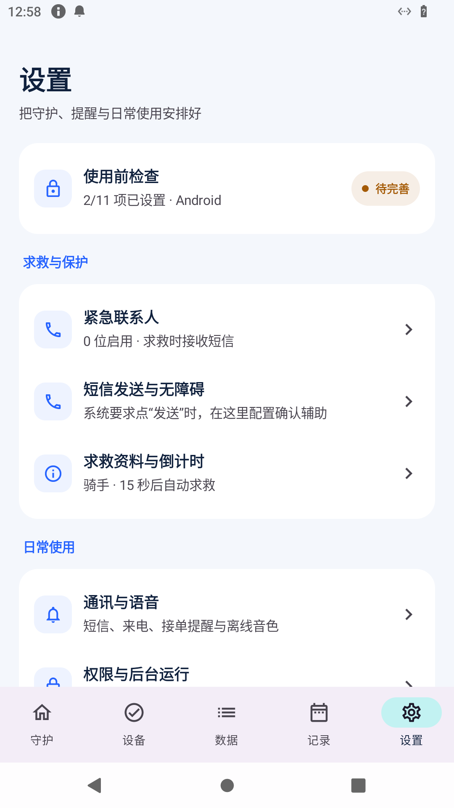
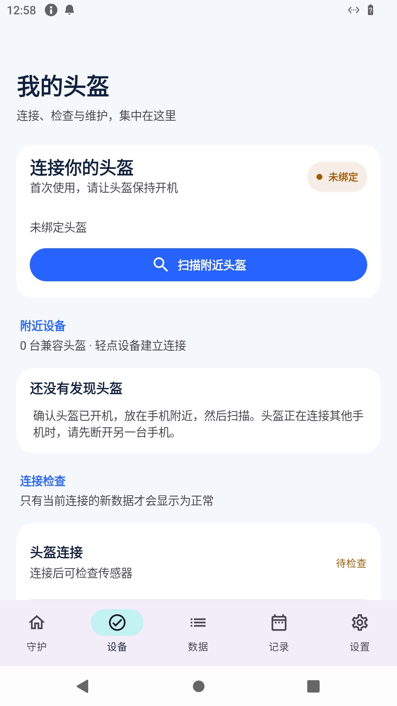
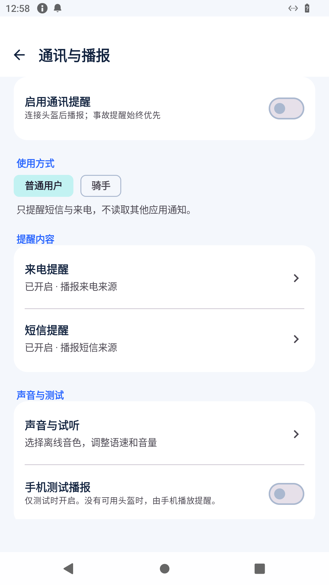

# HelmetGuard · 骑行守护

每一次出发，都有回应。

面向 ESP32-S3 智能头盔的 Android 应用：连接头盔、查看运动数据、处理事故提醒，并在骑行中播报短信、来电和接单通知。通知与语音在手机本地处理，不依赖 Google Play 服务。

**当前版本：2.4.0** · Android 12 及以上 · ARM64

[下载 2.4.0 安装包](https://github.com/Foreseer299/HelmetGuard/releases/download/v2.4.0/HelmetGuard-2.4.0-debug.apk) · [新版说明](docs/RELEASE_2.4.0.md) · [保留的 2.1 版本](https://github.com/Foreseer299/HelmetGuard/tree/release/2.1) · [2.1 安装包](https://github.com/Foreseer299/HelmetGuard/releases/tag/v2.1.0)

## 这次更新

首页“守护”和第三页“数据”保留原有视觉设计。设备、记录、联系人、设置和通讯播报重新整理：常用操作直接可见，详细参数进入专项页面，每个重要操作配有用途说明。

- **设备**：扫描、连接、校准、查找与重新连接；明确区分“连接成功”和“传感器数据正常”。
- **记录**：参数记录与事故事件分开查看，可筛选演练；删除前确认，提交与送达回执分开解释。
- **设置**：短信发送与无障碍有独立入口，权限、后台运行、求救资料不再挤在同一长页。
- **通讯**：普通用户选择短信和来电，骑手可增加自己选择的接单应用；来源、内容、声音和诊断分页面管理。
- **技术修补**：连接准备超时、失效回调、蓝牙权限撤销、位置时效与实时记录缓冲等问题一并修复。

<p>



</p>

截图来自 Android 测试环境，使用合成测试数据。

## 第一次使用

1. **设置 → 紧急联系人**：添加并启用接收求救短信的人。
2. **设置 → 权限与后台运行**：按实际状态完成授权和本机后台设置。
3. **设置 → 短信发送与无障碍**：选择求救 SIM。只有系统反复要求点击“发送”时，才按需开启短信确认辅助；随后分别做亮屏和锁屏实测。
4. **设备**：开启头盔并扫描连接，确认传感器数据已更新。
5. **设置 → 通讯与语音**：打开通知使用权，选择提醒来源和内容。无头盔时如需验证声音，临时开启“手机测试播报”。
6. 在安全环境进行模拟演练。**模拟事故不会真实发送求救短信**；“测试求救短信发送”则会发出标有“无需救援”的实际短信。

2.4.0 沿用 2.3.x 调试包名和签名，可覆盖安装；发布包为课程原型调试构建。升级无需清除已有记录。回退旧版请先导出需要的资料，Android 通常不允许直接降级安装。

## 给硬件与后端同学

| 内容 | 文档 |
| --- | --- |
| 安全协议与 2.1 联调约定 | [联调说明](docs/INTEGRATION_2.1.md) · [BLE 协议](docs/BLE_PROTOCOL.md) |
| 动态头盔音频 | [BLE 音频协议](docs/AUDIO_PROTOCOL_V1_DRAFT.md) |
| ESP32-S3 固件与接线 | [固件说明](firmware/README.md) |
| 事故检测与实验 | [检测说明](docs/ACCIDENT_DETECTION.md) |
| 手机与硬件测试 | [测试指南](docs/PHONE_AND_HELMET_TEST_GUIDE.md) |
| 语音模型来源 | [TTS 说明](docs/THIRD_PARTY_TTS.md) |

项目目前没有独立 HTTP 云端后端。头盔通过 BLE 与手机协作；手机生成本地语音，兼容固件可接收并播放。真实 BLE 吞吐、扬声器输出、双卡与厂商锁屏行为需要对应实机验收。

## 构建

JDK 17、Android SDK 35、Kotlin / Jetpack Compose / Room / DataStore。

```bash
# 准备固定版本的离线音色及运行库（脚本含哈希校验）
bash scripts/prepare_embedded_tts.sh
./gradlew testDebugUnitTest assembleDebug

# ESP32-S3 参考固件（需 PlatformIO）
cd firmware
pio test -e native
pio run
```

Android 代码位于 `app/`，参考固件位于 `firmware/`，接口及验证说明位于 `docs/`。正式发布应配置自己的安全签名；不要将私钥提交到仓库。

## 使用范围

短信提交成功与网络确认送达是不同状态，应用分别记录。无障碍辅助需主动开启，只处理符合识别条件的本应用短信确认，不代替授权、身份验证或解锁。Android 15 及以上重启后请打开应用确认通讯提醒服务恢复。

内置小雅音色用于当前非商业课程原型，模型卡及运行库许可分别见 TTS 文档。此项目是辅助安全原型，不能保证所有事故均被识别，也不能代替专业救援设备。

历史稳定入口保留在 `release/2.1`；仓库默认分支展示 2.4.0，不再把旧版说明作为主页。
