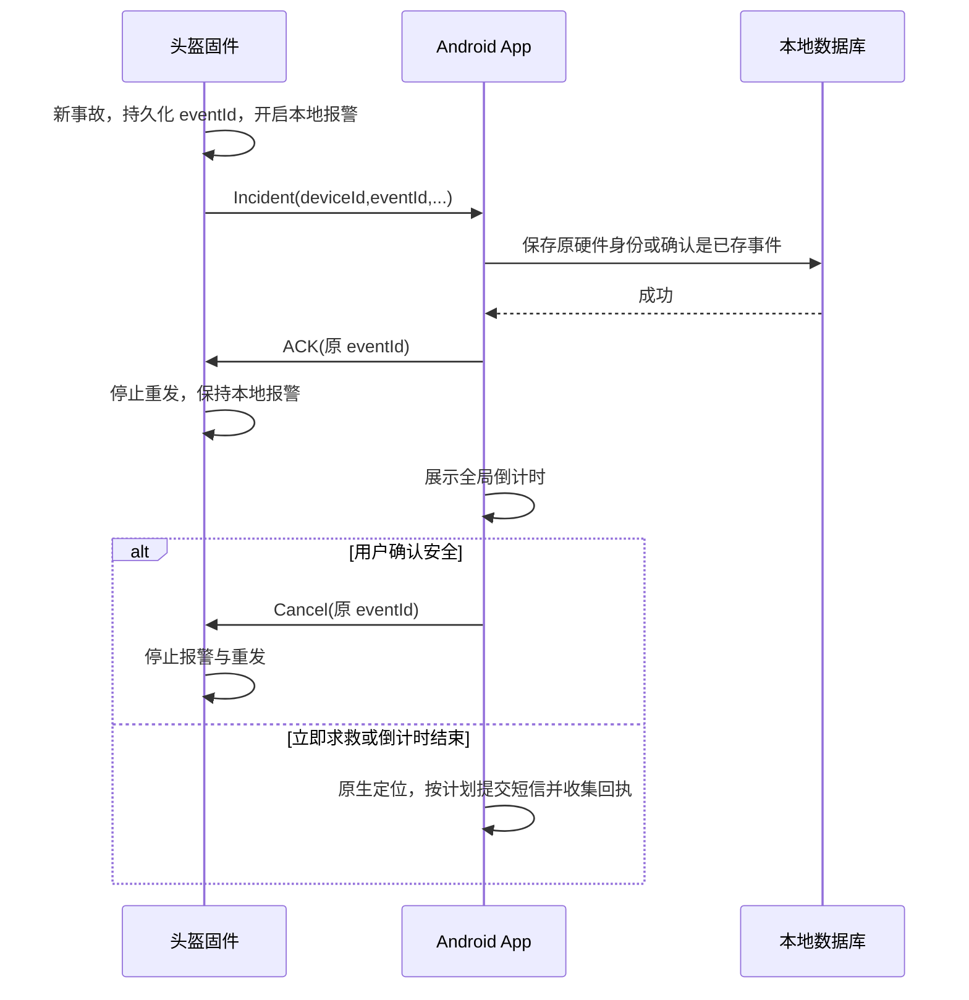

# HelmetGuard 2.1 联调接口与交接说明

给 Android、ESP32/固件同学共同使用。App 版本 **2.1.0**，线协议仍是 **V1 / 0x01**，没有因 App 升级而修改 UUID、CRC、缩放或命令字节。

本仓库的“后台”是 Android 守护服务；设备端是 ESP32。**当前没有自建 HTTP/WebSocket 云端 API**。如果另外还有云服务需求，需要单独约定接口，不能把本文当成已实现的云 API。

## 1. 从哪里开始

| 资料 | 用途 |
| --- | --- |
| [BLE_PROTOCOL.md](BLE_PROTOCOL.md) | 完整线协议定义，V1 的字节依据 |
| [protocol_vectors.json](protocol_vectors.json) | 原有 5 组跨语言固定向量 |
| [integration_vectors_2.1.json](integration_vectors_2.1.json) | 新增 4 组 ACK/Cancel 完整帧，含 unsigned eventId |
| [App 编解码器](../app/src/main/java/com/helmet/guard/core/ble/BleProtocol.kt) | Kotlin 实际实现 |
| [固件协议头](../firmware/include/HelmetProtocol.h) | C++ 编解码器 |
| [参考固件](../firmware/src/main.cpp) / [引脚配置](../firmware/include/BoardConfig.h) | 仓库设备端实现 |
| [2.1 修改与验收边界](RELEASE_2.1.md) | 修复、安装及待实机确认部分 |

用户提供的测试手册对应另一份 `helm_alarm.ino`，有 TEST_MODE、开机宽限期和自动静音等扩展。**这份实际 `.ino` 未在本仓库或附件中提供**，因此不能声称已经审查、修改或烧录了它。请固件同学对照本文核验自己的实际版本。

## 2. 发现、GATT 与发送节奏

| 项目 | 约定 |
| --- | --- |
| 广播设备名 | 以 `HelmetGuard` 开头，例如 `HelmetGuard-S3-XXXX` |
| 服务 | `0000FFF0-0000-1000-8000-00805F9B34FB` |
| 遥测 FFF1 | `0000FFF1-0000-1000-8000-00805F9B34FB`；Read + Notify；设备 → App |
| 事故/按键 FFF2 | `0000FFF2-0000-1000-8000-00805F9B34FB`；Read + Indicate；设备 → App |
| 命令 FFF3 | `0000FFF3-0000-1000-8000-00805F9B34FB`；Write；App → 设备 |
| CCCD | `00002902-0000-1000-8000-00805F9B34FB` |
| MTU | App 请求 64；Android 实际协商值可能不同 |
| 遥测建议 | 25 Hz；IMU 采样可为 50 Hz |
| 事故重发 | 同一事故约每秒重发，直到收到相同 eventId 的应用 ACK |

广播优先使用 16 位 `0xFFF0`，设备名放 scan response，避免广播 31 字节容量不足。App 优先订阅 FFF2 Indicate，也兼容仅 Notify 的已有实现。

FFF1、FFF2 各自重组分片；两者共用**按整帧递增**的设备发送 sequence。App 命令使用自己的独立 sequence。不要每个分片递增一次 sequence。

### 默认 MTU 23 必须单独验证

MTU 23 时单个 ATT 通知/指示最多容纳 20 字节；遥测整帧 31 字节，事故整帧 23 字节，需要固件主动分片。例如可分别分为 `20+11` 与 `20+3`。只在整帧末尾放 CRC，分片不能各加一套帧头/CRC。

App 支持这些分片重组，但**仓库参考固件目前直接整帧通知，默认 MTU 的设备端分片仍待实现/验证**；不能把 App 重组测试通过当成固件会自动分片。FFF2 若采用多次 Indicate，还要等待前一个 indication 的链路确认后发送下一片，避免“上一条指示仍在进行”。

## 3. 通用帧与 CRC

```text
AA 55 | version:u8 | type:u8 | sequence:u8 | payloadLength:u8 | payload:N | crc8:u8
```

- 总长 `N+7`，V1 的 payload 最大 128 字节。
- 所有多字节字段均为**小端**。
- CRC-8：poly `0x07`，初值 `0x00`，MSB-first，无反转，无最终异或。
- CRC 覆盖 **AA 55 开始到 payload 末尾**，仅排除最后 CRC 字节。
- sequence 为 0–255 回绕；CRC 错误、长度不符、协议版本不支持的业务帧不应被当成有效数据。
- 流可以分片或一次包含多帧；不要假设一次 BLE 回调就是一帧。

最小校验例：`AA 55 01 03 08 01 02 0F`。前七字节 CRC 是 `0F`；错误地排除 `AA 55` 会得到 `12`。

## 4. 设备 → App

### 4.1 遥测：type `01`，payload 24 字节

偏移均相对 payload。

| 偏移 | 类型 | 字段 | 线上单位 / App 换算 |
| ---: | --- | --- | --- |
| 0 | uint32 | deviceTimestamp | 开机毫秒；不是 Unix 时间 |
| 4、6、8 | int16 × 3 | ax、ay、az | 原值 / 1000 → g |
| 10、12、14 | int16 × 3 | gx、gy、gz | 原值 / 10 → °/s |
| 16、18、20 | int16 × 3 | roll、pitch、yaw | 原值 / 10 → ° |
| 22 | uint8 | batteryPercent | 0–100 |
| 23 | uint8 | flags | bit0：IMU 健康；bit1：校准有效；bit2：电量有效 |

静止时合加速度应约 1g。未接电池采样电路时发送 `battery=0` 并清除 bit2，不能发送 100 或 255 冒充电量。为兼容旧固件，App 仍把“非零电量但未设置 bit2”视为有效；真正的 0% 空电需要设置 bit2。

### 4.2 事故：type `02`，payload 16 字节

| 偏移 | 类型 | 字段 | 含义 |
| ---: | --- | --- | --- |
| 0 | uint32 | deviceId | 稳定设备身份；不能所有板子使用同一常量 |
| 4 | uint32 | eventId | 同一事故重发保持不变，新事故递增，建议 NVS 持久化 |
| 8 | int16 | impactPeak | 原值 / 100 → g |
| 10 | int16 | gyroPeak | **1 单位 = 1 °/s，不除以 100** |
| 12 | uint16 | stillDuration | 原值 / 10 → 秒 |
| 14 | uint8 | countdownSeconds | 5–30 有效；其他值由 App 使用自身设置 |
| 15 | uint8 | flags | bit0：请求应用 ACK；bit1：设备本地报警中 |

`deviceId/eventId` 是 unsigned 32 位，App 用 Long 保存完整范围。App 2.1 为事件另分配本地主键，**本地主键不能用于固件 ACK 或 Cancel**。

App 2.1 用 `(deviceId,eventId)` 去重，并保留原 BLE 地址，取消命令只发送给该事件关联的设备。刷机时应保留 NVS 事件计数。清空 NVS 后若重新使用同一 deviceId 和旧 eventId，可能被识别为历史重发；V1 没有独立的 boot/generation 字段，遇到这种情况应先协调身份策略，不要通过删除用户数据库掩盖问题。

当前 App 对硬件上报使用固定的 0.94 显示评分；这**不是固件传来的置信度字段，也不是医学风险概率**。

### 4.3 按键：type `03`，payload 1 字节

| 字节 | 固件/按键语义 | App 2.1 行为 |
| --- | --- | --- |
| `01` | 单击 | 忽略，不启动求救或取消 |
| `02` | 双击 | 仅在已有事故倒计时中立即求救；空闲时忽略 |
| `03` | 长按 | 固件本地取消警报；App 仅在倒计时阶段取消 |

短信进入定位/发送阶段后，长按不能撤回已交给系统的短信。附件描述的长按约 1.2 秒、双击窗口约 350ms，具体消抖由实际固件负责。

## 5. App → 设备

消息 type 始终为 `04`。下表长度是 payload 长度。

| 命令 | cmd | payload | 长度 | 设备预期 |
| --- | --- | --- | ---: | --- |
| ACK | `01` | cmd:u8 + eventId:u32 + status:u8 | 6 | 匹配事件后停止重发；**不等于关闭蜂鸣器** |
| Cancel | `02` | cmd:u8 + eventId:u32 + source:u8 | 6 | 匹配事件后取消报警、停止蜂鸣和重发 |
| Find | `03` | cmd:u8 + seconds:u8 | 2 | 找头盔响铃；App 默认 5 秒，范围 1–30 |
| Calibrate | `04` | cmd:u8 | 1 | 重新校准；保持头盔静止，以状态回读/串口确认完成 |
| Sync time | `05` | cmd:u8 + unixSeconds:u32 | 5 | 同步 Unix 秒；参考固件仅记录，不用于替代开机毫秒 |

App 当前 ACK 的 status、Cancel 的 source 默认均为 `00`。不要把命令当作固定 6 字节 payload，也不要用 Kotlin 枚举 ordinal 推导线上值。

Sync time 有编码接口，但当前 UI 不会自动执行它，固件不能依赖“连接后必然立即收到时间同步”。

协议目前没有通用命令应答消息。App GATT 队列“已排队”或系统 write 成功不能证明蜂鸣器已停/校准已完成；要通过串口、蜂鸣器、事件重发和校准状态实际核验。FFF2 的 Indicate 链路确认也不能替代上述 `01 ACK` 命令。

### 可以直接发给设备的 ACK / Cancel 向量

对应原固定事故向量的 `deviceId=11223344`、`eventId=55667788`：

```text
ACK    AA 55 01 04 2C 06 01 88 77 66 55 00 39
Cancel AA 55 01 04 2D 06 02 88 77 66 55 00 51
```

包含 unsigned 高位 eventId 的另外两组向量见 [integration_vectors_2.1.json](integration_vectors_2.1.json)。这些向量的 CRC 已与原 5 组固定向量使用同一规范核对；新增文件供跨端测试使用，不代表实际固件已运行过它们。

## 6. 事故时序与责任边界



- 写入失败时不应提前 ACK。重复事件只补 ACK，不重新倒计时；已取消事件重复到达时，也补 Cancel。
- 正在处理的手机算法事件可以关联首个硬件确认。另一独立硬件事件未被受理时暂不 ACK，让固件继续重发，之后再处理；不要把不同硬件 eventId 强行合并。
- 真实事故优先于 App 模拟演练；真实数据和模拟数据分别检测与记录。
- App “模拟实验”不会执行真实定位和短信；**真实固件上报属于真实求救链路**，TEST_MODE 的宽松阈值不会自动让 App 把事故当成模拟。
- 断连后本地蜂鸣、物理长按和硬件检测由固件独立保证，App 不在线时也应可用。
- 自动静音属于附件实际固件的扩展；如果只是停蜂鸣而事件仍待确认，仍需保持同一 eventId 的重发。ACK 和 Cancel 的区别不能因此改变。

## 7. 双方验收表

建议共享：App 提交 SHA、固件提交/版本、TEST_MODE、手机型号/Android 版本、协商 MTU，以及同一组 deviceId/eventId 的串口和 App 记录。可隐藏手机号及真实经纬度，不传密钥或完整私人数据。

| 编号 | 操作 | 应看到的结果 | 主要负责端 |
| --- | --- | --- | --- |
| I01 | 固件跑原 5 组固定向量 | 编码逐字节一致，CRC 包含 AA55 | 固件 |
| I02 | 连接并订阅 FFF1/FFF2 | 收到遥测，IMU/校准标志真实有效 | 双方 |
| I03 | 默认 MTU 23 分片，再在较大 MTU 测整帧 | 两种路径都能解出完整遥测与事故 | 双方；参考固件降级仍待办 |
| I04 | 发送固定事故向量 | 峰值 6.42g、731°/s、静止 2.5s，倒计时 15s | 双方 |
| I05 | 暂不 ACK，重复发相同事故 | App 仅有一次事件/倒计时，接受后补 ACK | 双方 |
| I06 | 收到 ACK | 串口确认同 eventId；重发停止，蜂鸣仍由本地报警状态控制 | 固件 |
| I07 | App 点“我安全” | Cancel 带原硬件 eventId；设备停鸣、停止重发 | 双方 |
| I08 | App 重启后重发已经取消的事故 | 不重新求救，补 ACK/Cancel | 双方 |
| I09 | 双击、长按、找头盔、校准 | 严格符合第 4/5 节；短按不取消 | 双方 |
| I10 | 切断蓝牙后触发，再重新连接 | 离线本地报警可用，未确认事件保留并重发 | 固件 + App 重连 |
| I11 | 两块设备使用相同 eventId | 不同 deviceId 不应被误去重；取消不得发送给另一块板 | 双方 |
| I12 | App 模拟演练、真实事故抢占演练 | 模拟不发真实短信；真实事故可受理 | App |
| I13 | 发送中断后恢复、双卡与运营商回执 | 不盲目重发全体；未确认分段明确告警，提交与送达分开 | App + 真实手机网络 |

最后一项和国内 ROM 锁屏/后台定位需要真机，Android 模拟器不能验收运营商送达。

## 8. 当前已有证据与未完成项目

- App 已有 20 项 JVM 测试与 11 项 Android 15 模拟器回归通过的运行记录，覆盖格式化、协议、事故页面/恢复/取消、模拟隔离、迁移及记录计数。最新结果可在 PR 的 Actions 检查和报告查看。
- 新增 ACK/Cancel JSON 是文档补充；原固定字节、App 命令编码和 unsigned ID 已有回归，未宣称实际 `.ino` 已消费新 JSON。
- BLE 实体设备、默认 MTU 固件分片、NVS 清空后的身份策略、华为锁屏后台和真实短信送达仍需双方按表验收。
- lint 构建无错误，但仍有旧依赖、新系统适配等警告；部分导航自定义 lint 规则因工具版本兼容性被跳过。未进行无关的整套依赖升级。

提问题时请至少给出 **Ixx 编号、双方版本、MTU、deviceId/eventId、期望与实际表现**。同一事件号贯穿串口和 App 记录，比只写“没反应”更容易定位。
